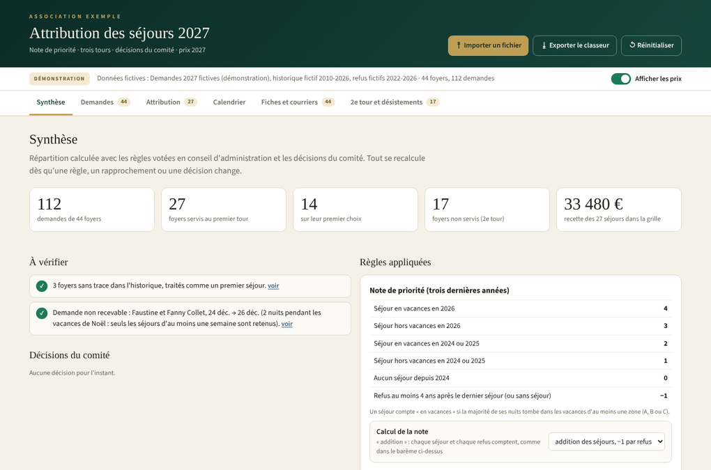

# Stay allocation for shared houses

*[Version française](README.md)*

A free, open-source tool for allocating stays in a house shared by the members of a nonprofit: a family house, a club chalet, an association's holiday home.

Everything is in a single file, `index.html`. You open it in a browser. There is nothing to install, no server and no account, and the data stays on the computer of the person using it.

The interface is in French, since the tool was built for French associations.

**Live demo, with fictional data: https://ced-p.github.io/attribution-sejours/**



## Background

The tool was built for a family association that runs a holiday house shared by several branches of one family. Every autumn, around fifty households ask for one to three periods for the following year. The stay committee has to settle overlapping requests and explain every refusal.

The tool applies the rules voted by the board. For each household, it writes an explanation of what was decided and why.

This public version has been generalised. It contains no real data: the demo data is fictional, and everything specific to the original association now lives in a configuration block.

## What it does

- **Priority score**: computed for each household from its stays over the last three years and from past refusals.
- **Three-step allocation**:
  1. a household that is alone on its dates gets them;
  2. otherwise, the lowest score wins;
  3. on equal scores, tie-break criteria apply in the order you choose.
- **Committee decisions**: give a slot to another household, shift dates subject to agreement, or set a request aside. Everything is recomputed around these decisions.
- **Explanations and letters**: for each household, what happened to each of its choices, then a ready-to-send letter (approval, conditional approval or refusal with reasons). The templates can be edited.
- **Calendar, second round and cancellations**: a view of the year, the slots still free, and the households not yet served, in priority order.
- **Exports**:
  - the working Excel workbook;
  - at the end of the season, next year's workbook with history and refusals updated;
  - a CSV of contacts for personalised mailing.

## Try it

The quickest way is the [live demo](https://ced-p.github.io/attribution-sejours/). To run it on your own computer:

1. Download `index.html`.
2. Open it in a browser.

It starts on fictional data: 44 households and 112 requests.

## Use it with your own data

1. Edit the `CONFIG` object at the top of the script. It holds:
   - the association and place names;
   - the campaign year;
   - the price grid;
   - school holidays and public holidays.
2. Fill in `exemples/modele_vierge.xlsx`. `exemples/classeur_exemple.xlsx` shows the same workbook filled with fictional data.
3. Click « Importer un fichier » to load it.

## Default scoring

| Household situation | Score |
|---|---|
| Stay during school holidays last year | 4 |
| Stay outside school holidays last year | 3 |
| Stay during school holidays two or three years ago | 2 |
| Stay outside school holidays two or three years ago | 1 |
| No stay in three years, or never came | 0 |
| Refusal at least four years after the last stay | −1 |

The lowest score has priority. On equal scores, the tie-break criteria are applied in an order you can change. By default the order is: full week, first stay, oldest last stay, service to the association.

Allocation uses deferred acceptance. Each household works through its choices in order of preference. A held request only gives way to a higher-priority request on overlapping dates. Each household gets at most one stay in the first round.

## Privacy

Nothing is sent to a server. Settings, decisions and the last imported file are kept in the browser's `localStorage`. Do not publish an `index.html` that contains your real data.

## Tests

```
node --test
```

This requires Node 18 or later. The tests load the allocation engine straight from `index.html`.

## Author and license

Built with help from Claude (Anthropic). MIT license: see [LICENSE](LICENSE).
