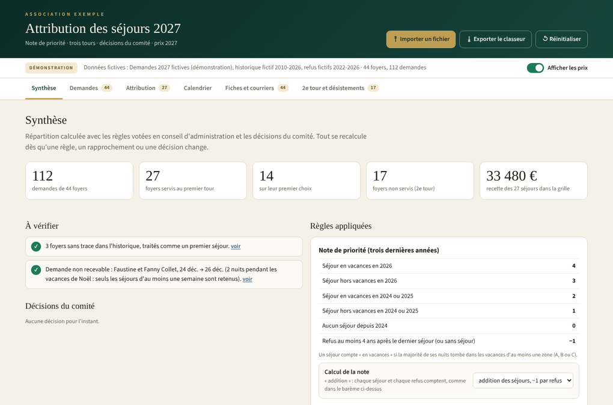
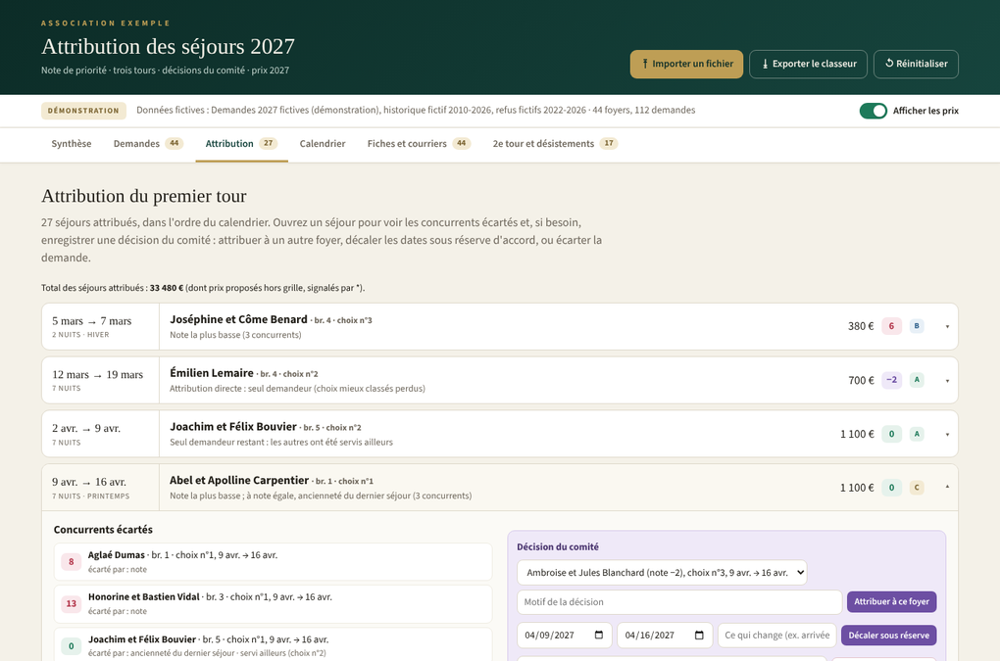

# Attribution des séjours

*[English version](README.en.md)*

Un outil libre pour répartir les séjours dans une maison partagée par les membres d'une association : maison de famille, gîte associatif, chalet de club…

Tout tient dans un seul fichier, `index.html`. On l'ouvre dans un navigateur, sans installation, sans serveur et sans compte. Les données restent sur l'ordinateur de la personne qui s'en sert.



## D'où vient cet outil

Il a été construit pour une association familiale qui gère une maison de vacances partagée par plusieurs branches d'une même famille. Chaque automne, une cinquantaine de foyers demandent une à trois périodes pour l'année suivante. Le comité des séjours doit trancher entre des demandes qui se chevauchent, puis expliquer chaque refus.

L'outil applique les règles votées par le conseil d'administration et rédige, pour chaque foyer, une explication écrite de ce qui a été décidé et pourquoi.

Cette version publique a été généralisée. Elle ne contient aucune donnée réelle : les données de démonstration sont fictives, et tout ce qui était propre à l'association d'origine se règle désormais dans un bloc de configuration.

## Ce que fait l'outil

- **Note de priorité** : calculée pour chaque foyer à partir de ses séjours des trois dernières années et de ses refus passés.
- **Attribution en trois étapes** :
  1. un foyer seul à demander des dates les obtient ;
  2. sinon, la note la plus basse l'emporte ;
  3. à note égale, des critères de départage s'appliquent dans l'ordre que vous choisissez.
- **Décisions du comité** : attribuer un créneau à un autre foyer, décaler des dates sous réserve d'accord, écarter une demande. Tout se recalcule autour de ces décisions.
- **Explications et courriers** : pour chaque foyer, le sort de chacun de ses choix, puis un courrier prêt à envoyer (accord, accord sous réserve ou refus motivé). Les modèles sont modifiables.
- **Calendrier, deuxième tour et désistements** : vue de l'année, créneaux restés libres, foyers non servis par ordre de priorité.
- **Exports** :
  - le classeur Excel de travail ;
  - en fin de saison, le classeur de l'année suivante, avec l'historique et les refus complétés ;
  - les contacts en CSV (format compatible Brevo) pour un envoi personnalisé.



## Essayer

1. Téléchargez `index.html`.
2. Ouvrez-le dans Chrome, Edge, Firefox ou Safari.

Il démarre sur des données fictives : 44 foyers et 112 demandes. Une connexion internet est nécessaire au premier chargement, pour la bibliothèque qui lit les fichiers Excel et pour les polices.

## Utiliser l'outil avec vos données

1. **Configurer.** Ouvrez `index.html` dans un éditeur de texte. En haut du script, l'objet `CONFIG` regroupe tout ce qui est propre à votre association :
   - le nom de l'association et du lieu ;
   - l'année de campagne et la signature des courriers ;
   - la grille tarifaire ;
   - les vacances scolaires et les jours fériés ;
   - les couleurs des branches.
2. **Préparer le classeur.** Partez de `exemples/modele_vierge.xlsx`. Le fichier `exemples/classeur_exemple.xlsx` montre le même classeur rempli avec les données fictives.
3. **Importer.** Cliquez sur « Importer un fichier ». L'import remplace les données de démonstration.
4. **Régler et décider.** Dans l'onglet Synthèse, ajustez les règles : mode de calcul de la note, ordre des critères, semaine complète prioritaire, durée minimale à Noël. Vérifiez ensuite les rapprochements dans l'onglet Demandes et enregistrez les décisions du comité dans l'onglet Attribution.
5. **Communiquer.** L'onglet Fiches et courriers prépare un courrier par foyer et l'export CSV.
6. **Clôturer.** En fin de saison, « Clôturer » produit le classeur de l'année suivante. C'est lui qu'on importera l'an prochain.

### Le classeur

| Onglet | Une ligne par… | Colonnes utilisées |
|---|---|---|
| Demandes | foyer demandeur | Correspondant, Branche (ex. `(2) Bouleau`), Horodateur, Adresse e-mail, Nom, Prénom, Choix nº1 à nº3 (date de début, date de fin), Option, Commentaires |
| Historique séjours | séjour effectué | An, Début, Fin, Nom, Prénom, Annuaire (référence du foyer), Branche |
| Refus | foyer non servi une année donnée | An, Nom, Prénom, Ref annuaire, Source |

L'application reconnaît les onglets par leurs en-têtes, pas par leur nom. Les colonnes de l'onglet Demandes correspondent à l'export d'un formulaire Google Forms.

## Les règles par défaut

| Situation du foyer | Note |
|---|---|
| Séjour en vacances scolaires l'an dernier | 4 |
| Séjour hors vacances l'an dernier | 3 |
| Séjour en vacances il y a deux ou trois ans | 2 |
| Séjour hors vacances il y a deux ou trois ans | 1 |
| Aucun séjour depuis trois ans, ou jamais venu | 0 |
| Refus survenu au moins quatre ans après le dernier séjour | −1 |

La note la plus basse est la plus prioritaire. Par défaut, les séjours des trois dernières années s'additionnent. Un réglage permet de ne compter que le dernier séjour.

À note égale, l'ordre des critères de départage est réglable. Par défaut : semaine complète, premier séjour, ancienneté du dernier séjour, service rendu à l'association. Une égalité parfaite remonte au comité.

L'attribution suit un principe d'acceptation différée : chaque foyer avance dans ses choix par ordre de préférence. Une demande retenue ne cède sa place qu'à une demande prioritaire sur les mêmes dates. Chaque foyer obtient au plus un séjour au premier tour.

## Confidentialité

- Rien n'est envoyé sur un serveur. Les réglages, les décisions et le dernier fichier importé sont enregistrés dans le navigateur (`localStorage`).
- Ne mettez pas en ligne un fichier `index.html` dans lequel vous auriez intégré vos vraies données. Le fichier publié ici ne contient que des données fictives.

## Limites connues

- Les vacances scolaires et les jours fériés sont à mettre à jour dans `CONFIG` pour chaque nouvelle campagne. Le calendrier pris en compte est celui de la France (zones A, B et C).
- Le rapprochement entre demandes et historique se fait sur le nom et le prénom, avec une tolérance aux fautes de frappe. Les cas ambigus sont signalés et se corrigent à la main dans l'onglet Demandes.
- Chaque navigateur a sa propre session. Deux personnes sur deux ordinateurs ont chacune leurs réglages. C'est le classeur exporté qui fait référence.
- La bibliothèque SheetJS est chargée en version 0.18.5. Passer à une version récente est la prochaine étape.
- L'interface est en français.

## Tests

```
node --test
```

Il faut Node 18 ou plus. Les tests chargent le moteur d'attribution directement depuis `index.html` et vérifient le barème, les trois étapes, les cas limites et les décisions forcées.

## Contribuer

Les remarques et propositions sont bienvenues, en français ou en anglais, dans les *issues*. Si vous utilisez l'outil pour votre association, un petit mot fait toujours plaisir.

## Auteur et licence

Développé avec l'aide de Claude (Anthropic). Licence MIT : voir [LICENSE](LICENSE).
